# trajectory-to-training

When tests are the only label, 4 of 10 fine tuning rows came from runs that gamed their tests.

This repo turns coding agent runs into training data. It labels each run by its test result, checks the passing runs a second way, and keeps the runs that cheated out of the data. The second check compares each passing run with a reference solution on inputs the tests never use. On 14 runs written for this repo, it caught all 4 gamed runs and flipped no honest run.

<picture>
  <source media="(prefers-color-scheme: dark)" srcset="docs/assets/hero-dark.svg">
  
</picture>

<sub>Related repos:<br>
[agent-harness](https://github.com/pdj555/agent-harness) · [agent-eval-harness](https://github.com/pdj555/agent-eval-harness) · **trajectory-to-training** · [hard-rag-evals](https://github.com/pdj555/hard-rag-evals)</sub>

## The finding

14 runs: two tasks, seven attempts each. Three honest solutions, two that game the tests, two that fail, per task. Every run was labeled by running its code against the task tests in a separate interpreter (`examples/gamed_runs.py`). Then the batch went through the pipeline twice.

| Label | Fine tuning rows | Rows from gamed runs | Pairs where a gamed run is "chosen" |
| --- | --- | --- | --- |
| Tests alone | 10 | 4 | 2 of 2 |
| Tests plus the second check | 6 | 0 | 0 of 2 |

Both tasks are easy to game because their tests cover so little. `split_cents` is tested on 3 calls, and one gamed run is a lookup table of those 3 calls. `fizzbuzz_plus` is tested up to 7, and 7 is the one number where the tests cannot tell the real rule from two wrong ones. The four gamed runs were wrong on 104 to 631 of the hidden inputs the second check uses.

The pairs column needs one note. The pair builder picks the passing run with the fewest steps. The gamed runs were written with fewer steps, the way a shortcut goes, so a gamed run is "chosen" in both pairs. With equal steps, the first passing run in the batch would win instead.

The shape of the problem is general. The label is the test result, the test suite is always smaller than the input space, and a run that fits the tests instead of the task earns the same label as a run that solves it.

## Run it

Python 3.10 or later, standard library only.

```bash
python3 examples/gamed_runs.py       # the finding above, reproduced end to end
python3 examples/worked_example.py   # the full pipeline on 200 synthetic runs
python3 examples/deep_dive.py        # scoring, structural dedup, repair, curriculum, mixing
python3 -m pytest tests/             # 3 tests, including the second check on the real batch
```

## How it works

<picture>
  <source media="(prefers-color-scheme: dark)" srcset="docs/assets/flow-animated-dark.svg">
  
</picture>

1. `collector` records one trajectory per attempt: the prompt, the tool calls, the final code, and the verification result (tests passed, tests total).
2. Each run gets a quality score. Gates then drop runs that failed, runs outside the length bounds, and exact duplicates, and cap the runs per task. A separate pass drops structural duplicates: same code shape, different names.
3. `filter/second_check.py` runs a check the caller supplies on every run that passed its tests. A run the check fails is marked failed. The original run is not changed.
4. Passing runs become fine tuning rows. Each task with both a pass and a failure gives one preference pair: the best passing run as "chosen", the worst failing run as "rejected".
5. A failed run can be rebuilt from a passing run on the same task, with the source recorded. Rows can be split by task type, ordered easy to hard, and mixed toward the task types with the lowest pass rates.

## What the second check cannot do

- It needs a reference solution, or some other check the caller trusts, and most real tasks do not ship one.
- It trusts that check completely. A wrong reference flips honest runs, and nothing in the code guards against that.
- It compares outputs for exact equality. A run that is right but returns its answer in a different shape fails the check.

## Limits

- The 14 runs are small and were written by hand for this experiment. Both tasks were picked because their tests are easy to game.
- The 200 run batches in the other two examples are synthetic. Their numbers describe the pipeline, not real agents.
- No model has been trained on the output yet. Nothing here shows that cleaner data trains a better model. That test is listed in the research summary.

## Docs

[Research summary](docs/research.md) · [Guide](docs/guide.md)
