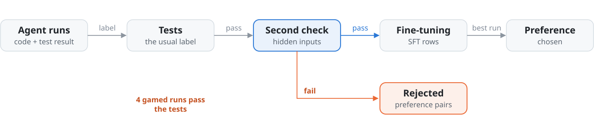

# trajectory-to-training

With tests as the only label, 4 of 10 fine tuning rows came from runs that gamed their tests. This repo turns coding agent runs into training data. It labels each run, checks the labels a second way, and keeps the runs that cheated out of the data.

<picture>
  <source media="(prefers-color-scheme: dark)" srcset="docs/assets/hero-dark.svg">
  
</picture>

<sub>One question, four repos: **how can we trust agents to merge without a human reading every diff?**<br>
[agent-harness](https://github.com/pdj555/agent-harness) · [agent-eval-harness](https://github.com/pdj555/agent-eval-harness) · **trajectory-to-training** · [hard-rag-evals](https://github.com/pdj555/hard-rag-evals)</sub>

## The finding

Models learn from whatever passes. Coding agents improve by training on their own runs, and the usual label is whether the tests passed. A run that games its tests passes too. On 14 real runs across two tasks, verified by running their tests:

| Label | Fine-tuning rows | From gamed runs | Gamed run as "chosen" |
| --- | --- | --- | --- |
| Tests alone | 10 | **4** | **2 of 2 pairs** |
| Tests plus a second check | 6 | 0 | 0 of 2 pairs |

The second check compares each run with a reference on inputs the tests never use. It caught all 4 gamed runs and flipped no honest run. The chosen column rests on step counts: the gamed runs took fewer steps, and the code that builds preference pairs breaks ties by steps.

## Run it

Python 3.10+, standard library only.

```bash
python3 examples/gamed_runs.py       # gamed runs, with and without a second check
python3 examples/worked_example.py   # collect, filter, emit SFT and preference data
python3 examples/deep_dive.py        # scoring, structural dedup, repair, curriculum, mixing
```

## How it works

<picture>
  <source media="(prefers-color-scheme: dark)" srcset="docs/assets/flow-dark.svg">
  
</picture>

1. **Collect.** One trajectory per attempt: prompt, tool calls, final code, test result.
2. **Filter.** A verification gate, length bounds, structural duplicates removed, and a cap for each task.
3. **Check again.** `filter/second_check.py` relabels runs that pass their tests but fail an independent check.
4. **Emit.** Fine tuning rows, preference pairs from the same task, and a stratified split that keeps the same mix in each part.
5. **Order and mix.** Easy to hard, weighted toward the task types the model fails most.

## Limits

- The second check needs a reference, and most real tasks do not ship one.
- The 14 runs were written by hand; the deep dive's 200 runs are synthetic.
- No model has been trained on the output yet.

## Docs

[Research summary](docs/research.md) · [Guide](docs/guide.md)
