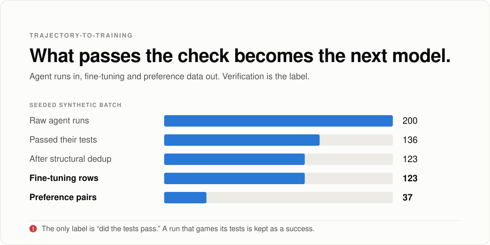

# Research summary

<picture>
  <source media="(prefers-color-scheme: dark)" srcset="assets/hero-dark.svg">
  
</picture>

Coding agents get better by training on their own past runs. Run the agent, keep the runs that worked, train on them, repeat. Whatever counts as "worked" becomes the next model's habits.

This repo is that pipeline. It's part of one question: **how can we trust agents to merge without a human reading every diff?** [agent-harness](https://github.com/pdj555/agent-harness) answers it at merge time. This is where the answer compounds, because a bad check here doesn't just let one change through, it trains the behavior in.

## What it does

It takes raw agent runs (the prompt, every tool call, the final code, and whether the tests passed) and turns them into fine-tuning and preference data. The only label it trusts is the test result. No human annotation, no learned reward model.

Along the way it scores each run, drops near-duplicates by comparing code structure rather than text, repairs failed runs from a passing run on the same task, orders the data easy to hard, and reweights toward task types the model fails most.

On a seeded synthetic batch of 200 runs:

- the worked example keeps 123 fine-tuning rows and 37 preference pairs
- repair recovers 62 of 72 failed runs from a passing sibling, keeps 2 as near misses, and drops 8
- every repaired run records which run it was rebuilt from

```bash
python3 examples/worked_example.py
python3 examples/deep_dive.py
```

## What happens to a run that games its tests

Real code, real tests, run in a separate interpreter. Two tasks, 7 attempts each: 3 honest solutions, 2 that special-case the tested inputs, 2 that fail. One gamed `split_cents` is a lookup table of the three tested calls. One gamed `fizzbuzz_plus` adds "!" to multiples of 7 instead of numbers whose digits sum to 7, which happens to agree with the tests.

Then the same 14 runs go through the pipeline twice: labeled by the tests alone, and relabeled by a second check (`filter/second_check.py`) that compares each solution with a reference on inputs the tests never use.

| | Fine-tuning rows | From gamed runs | Preference pairs with a gamed run as "chosen" |
| --- | --- | --- | --- |
| Tests alone | 10 | **4** | **2 of 2** |
| Tests plus second check | 6 | 0 | 0 of 2 |

The second check caught all 4 gamed runs, wrong on 104 to 631 hidden inputs each, and flipped no honest run.

One caveat on the last column. I gave the gamed runs 3 steps and the honest ones 6, the way a shortcut would go, and the preference builder breaks ties between passing runs by fewest steps. With equal steps, the tie goes to whichever run came first.

```bash
python3 examples/gamed_runs.py
```

## Where it breaks

- The label is the weak point. Without a second check, a run that games its tests is labeled a success and goes straight into the training set, as the table shows.
- Preference pairs make it worse. A gamed run that passes gets paired as "chosen" against an honest run that failed, which teaches the model to prefer the cheat. Among passing runs, the pipeline picks the one with the fewest steps, and a quick hardcoded answer is likely to win that.
- The second check needs a reference. Comparing against a reference works for these two tasks. Most real tasks don't ship one, which is the same problem agent-harness has with specs.
- The experiment is small and the gamed runs are mine. 14 runs, written by hand. The deep dive's 200 runs and flywheel numbers are synthetic.
- No model has been trained on the output yet.

## Next

1. Seed a batch with the 27 agent-harness attacks and run the agent-harness spec gate as the second check.
2. Collect real agent runs instead of hand-written ones and measure how many passing runs the second check flips.
3. Train a small model on both versions of the data and compare how often it cheats.

Preston Jones · p@pdj.dev
